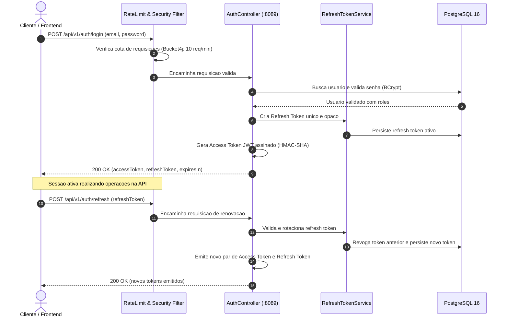

# Sales Management System Backend

API RESTful de alta performance para gerenciamento comercial e vendas de veículos, desenvolvida com **Java 17**, **Spring Boot 3.4**, **Spring Security**, **JWT (Bearer)**, **Spring Data JPA**, **PostgreSQL** e **Flyway**.

A aplicação oferece autenticação stateless com controle granular de acesso (`ADMIN`, `SUPERVISOR`, `SELLER`), rotação atômica de refresh tokens, gestão de equipes comerciais, carteira de clientes, inventário de veículos e marcas, auditoria automatizada de entidades, limitação de taxa de requisições com Bucket4j e observabilidade com Spring Boot Actuator e Micrometer.

---

## Arquitetura em Camadas do Backend

```mermaid
flowchart TD
    subgraph Client ["Clientes e Consumidores"]
        Frontend["Frontend SPA (Angular 21)<br/>Porta 4200"]
        Swagger["Swagger UI / OpenAPI<br/>/swagger-ui/index.html"]
    end

    subgraph SecurityLayer ["Camada de Seguranca e Filtros"]
        RateLimit["RateLimitFilter (Bucket4j)<br/>Token Bucket por IP"]
        MDC["CorrelationIdFilter<br/>Rastreabilidade SLF4J MDC"]
        JWTFilter["SecurityFilter (OncePerRequestFilter)<br/>Validacao de Tokens JWT e Claims"]
    end

    subgraph WebLayer ["Camada Web / Controllers REST (:8089)"]
        AuthController["AuthController<br/>/api/v1/auth"]
        VehicleController["VehicleController<br/>/api/v1/vehicles"]
        BrandController["BrandController<br/>/api/v1/brands"]
        CustomerController["ClienteController<br/>/api/v1/clientes"]
        SaleController["RegistroDiarioController<br/>/api/v1/registros-diarios"]
        TeamController["EquipeController<br/>/api/v1/equipes"]
        UserController["UserController<br/>/api/v1/users"]
        Actuator["Actuator Endpoints<br/>/actuator/health e metrics"]
    end

    subgraph ServiceLayer ["Camada de Servicos e Negocio"]
        AuthService["AuthService / RefreshTokenService"]
        VehicleService["VehicleService"]
        BrandService["BrandService"]
        ClienteService["ClienteService"]
        RegistroDiarioService["RegistroDiarioService"]
        EquipeService["EquipeService"]
        UserService["UserService"]
    end

    subgraph DataLayer ["Camada de Acesso a Dados e Persistencia"]
        Repo["Spring Data JPA Repositories<br/>+ JPA Specifications"]
        Mappers["MapStruct Mappers<br/>DTOs <-> Entidades"]
        Auditing["AuditingEntityListener<br/>createdAt / updatedAt / createdBy"]
        Flyway["Flyway Migrations<br/>db/migration (V1..V4)"]
        DB[("PostgreSQL 16<br/>sales_management")]
    end

    Frontend --> RateLimit
    Swagger --> RateLimit
    RateLimit --> MDC
    MDC --> JWTFilter
    JWTFilter --> WebLayer

    WebLayer --> ServiceLayer
    ServiceLayer --> Mappers
    ServiceLayer --> Repo
    Repo --> Auditing
    Auditing --> DB
    Flyway -.->|"Migracoes automaticas"| DB
```



---

## Fluxo de Autenticação e Renovação de Sessão

Diagrama de sequência exibindo o ciclo de login, emissão de Access Token (JWT), rotação de Refresh Token e autorização por papel:



---

## Estrutura de Diretórios do Projeto

```text
sales-management-system-backend/
├── src/main/java/com/commercial_management_system/backend/
│   ├── config/                        # Configuracoes de seguranca, rate limit, CORS e Swagger
│   │   ├── beansConfig/               # Configuracao de auditoria (AuditorAware)
│   │   ├── CorrelationIdFilter.java   # Injecao de correlationId no SLF4J MDC
│   │   ├── CorsConfig.java            # Politicas de CORS da aplicacao
│   │   ├── OpenApiConfig.java         # Documentacao OpenAPI 3.0 / Swagger
│   │   ├── RateLimitFilter.java       # Filtro Token Bucket com Bucket4j
│   │   ├── RateLimitProperties.java   # Propriedades configuraveis de rate limit
│   │   ├── SecurityConfigurations.java# SecurityFilterChain e PasswordEncoder
│   │   └── SecurityFilter.java        # OncePerRequestFilter para validacao JWT
│   │
│   ├── controller/                    # Endpoints REST (Auth, Veiculos, Clientes, Equipes, etc.)
│   ├── dto/                           # Records de requisicao e resposta imutaveis
│   ├── enums/                         # Enums de dominio (UserType, VehicleType, etc.)
│   ├── exception/                     # Tratamento global de excecoes (GlobalExceptionHandler)
│   ├── mapper/                        # Mapeamento DTO <-> Entidade via MapStruct
│   ├── model/                         # Entidades JPA (User, Vehicle, Cliente, Equipe, etc.)
│   ├── repository/                    # Interfaces Spring Data JPA
│   ├── service/                       # Regras de negocio e orquestracao de servicos
│   └── specifications/                # Filtros dinamicos com JPA Criteria
│
├── src/main/resources/
│   ├── db/migration/                  # Migracoes Flyway versionadas (V1 a V4)
│   └── application.yaml               # Parametrizacao centralizada do Spring Boot
│
├── src/test/java/                     # Suite de 68 testes automatizados (unitarios, integracao e seguranca)
├── .env.example                       # Modelo de variaveis de ambiente
├── pom.xml                            # Dependencias Maven e plugins de build
└── README.md                          # Este documento
```

---

## Configuração de Variáveis de Ambiente (.env)

O backend utiliza a biblioteca `spring-dotenv` para leitura automática do arquivo `.env` na raiz do módulo. Copie o arquivo modelo antes de iniciar:

```bash
cp .env.example .env
```

### Detalhamento das Variáveis

| Variável | Padrão | Descrição |
| :--- | :--- | :--- |
| `SERVER_PORT` | `8089` | Porta HTTP onde o backend executa |
| `DB_URL` | `jdbc:postgresql://localhost:5432/sales_management` | URL JDBC de conexão com o PostgreSQL |
| `DB_USERNAME` | `postgres` | Usuário do PostgreSQL |
| `DB_PASSWORD` | `postgres` | Senha de autenticação do PostgreSQL |
| `JWT_SECRET` | `sua_chave_secreta_aqui` | Chave secreta HMAC-SHA (mínimo de 256 bits) para assinatura JWT |
| `RATE_LIMIT_ENABLED` | `true` | Ativa ou desativa a limitação de requisições |
| `RATE_LIMIT_AUTH_CAPACITY` | `10` | Capacidade máxima de requisições de autenticação por intervalo |
| `RATE_LIMIT_AUTH_REFILL_TOKENS` | `10` | Quantidade de tokens repostos por ciclo de auth |
| `RATE_LIMIT_AUTH_DURATION` | `60` | Duração do ciclo de auth em segundos |
| `RATE_LIMIT_GENERAL_CAPACITY` | `60` | Capacidade máxima de requisições gerais por intervalo |
| `RATE_LIMIT_GENERAL_REFILL_TOKENS` | `60` | Tokens repostos por ciclo geral |
| `RATE_LIMIT_GENERAL_DURATION` | `60` | Duração do ciclo geral em segundos |
| `FLYWAY_ENABLED` | `true` | Ativa a execução automática das migrações Flyway |
| `FLYWAY_BASELINE_ON_MIGRATE` | `true` | Habilita criação de linha de base automática |
| `FLYWAY_BASELINE_VERSION` | `1` | Versão inicial considerada na linha de base |
| `CORS_ALLOWED_ORIGINS` | `http://localhost:4200` | Origens web autorizadas no CORS |

---

## Como Executar

### Pré-requisitos
- **Java JDK 17 ou 21** instalado:
  ```bash
  java -version
  ```
- **PostgreSQL 16** instalado e em execução:
  ```bash
  systemctl status postgresql
  ```

---

### Passo 1: Criar a Base de Dados

Conecte-se ao seu PostgreSQL local e crie o banco de dados `sales_management`:

```sql
CREATE DATABASE sales_management;
```

---

### Passo 2: Executar a Aplicação Spring Boot

```bash
mvn spring-boot:run
# ou utilizando o Maven Wrapper:
./mvnw spring-boot:run
```

A aplicação inicializará na porta `8089` e aplicará automaticamente todas as migrações do Flyway.

---

## Endpoints e Documentação Interativa

Acesse a documentação interativa Swagger UI e o contrato OpenAPI em:

* **Swagger UI**: [http://localhost:8089/swagger-ui/index.html](http://localhost:8089/swagger-ui/index.html)
* **OpenAPI 3.0 JSON**: [http://localhost:8089/v3/api-docs](http://localhost:8089/v3/api-docs)

### Resumo das Rotas Principais

| Módulo | Método | Endpoint | Acesso | Descrição |
| :--- | :--- | :--- | :--- | :--- |
| **Auth** | `POST` | `/api/v1/auth/login` | Público | Autenticação por e-mail e senha |
| **Auth** | `POST` | `/api/v1/auth/refresh` | Público | Rotação e renovação de tokens |
| **Auth** | `POST` | `/api/v1/auth/logout` | Autenticado | Revogação de sessão ativa |
| **Veículos** | `GET` | `/api/v1/vehicles` | Autenticado | Consulta com filtros (`name`, `color`, `price`, `type`) |
| **Veículos** | `POST` | `/api/v1/vehicles` | Supervisor / Admin | Cadastro de novo anúncio com validação |
| **Veículos** | `PUT` | `/api/v1/vehicles/{id}` | Supervisor / Admin | Atualização de dados cadastrais |
| **Veículos** | `DELETE`| `/api/v1/vehicles/{id}` | Supervisor / Admin | Remoção do veículo |
| **Marcas** | `GET` | `/api/v1/brands` | Autenticado | Listagem de marcas automotivas |
| **Marcas** | `POST` | `/api/v1/brands` | Supervisor / Admin | Cadastro de marca com lock otimista (`@Version`) |
| **Clientes** | `GET` | `/api/v1/clientes` | Autenticado | Consulta paginada da carteira de clientes |
| **Clientes** | `POST` | `/api/v1/clientes` | Autenticado | Cadastro de cliente com validação de dados |
| **Clientes** | `PATCH`| `/api/v1/clientes/{id}` | Autenticado | Atualização parcial de dados do cliente |
| **Equipes** | `GET` | `/api/v1/equipes` | Supervisor / Admin | Consulta da equipe comercial |
| **Equipes** | `POST` | `/api/v1/equipes` | Supervisor / Admin | Criação de equipe e associação de vendedores |
| **Registros**| `GET` | `/api/v1/registros-diarios` | Autenticado | Histórico de indicadores comerciais |
| **Registros**| `POST` | `/api/v1/registros-diarios` | Vendedor | Lançamento diário de metas e fechamentos |
| **Saúde** | `GET` | `/actuator/health` | Autenticado / Admin | Diagnóstico de integridade do banco e aplicação |
| **Métricas** | `GET` | `/actuator/metrics` | Admin | Coleta de métricas JVM e HikariCP |

---

## Auditoria de Dados (JPA Auditing)

As entidades do sistema utilizam auditoria automática do Spring Data JPA com `AuditingEntityListener`:

| Campo | Finalidade |
| :--- | :--- |
| `createdAt` | Data e hora exatas de criação do registro |
| `updatedAt` | Data e hora da última modificação |
| `createdBy` | ID do usuário autenticado responsável pela criação |
| `updatedBy` | ID do usuário autenticado responsável pela alteração |

A auditoria é gerenciada de forma transparente pelo backend através do componente `AuditorAware<Long>`, impedindo manipulação manual nas requisições.

---

## Segurança e Rate Limiting (Bucket4j)

A aplicação conta com proteção nativa contra força bruta e sobrecarga:
- **Rotas de Autenticação (`/api/v1/auth/**`)**: Limite de 10 requisições por minuto por IP.
- **Rotas Gerais (`/api/v1/**`)**: Limite de 60 requisições por minuto por IP.
- **Cabeçalhos de Resposta**:
  - `X-Rate-Limit-Remaining`: Requisições restantes na janela ativa.
  - `Retry-After`: Tempo de espera (em segundos) caso o limite seja atingido (`HTTP 429 Too Many Requests`).

---

## Execução da Suíte de Testes Automatizados

A aplicação dispõe de uma suíte abrangente com **68 testes automatizados** e 100% de aprovação funcional:

```bash
mvn test
# ou:
./mvnw clean test
```

### Categorias de Testes Cobertas
1. **Testes Unitários de Serviços**: Isolamento com Mockito (`BrandService`, `ClienteService`, `VehicleService`, `EquipeService`, `UserService`, `RefreshTokenService`, `RateLimitService`).
2. **Testes de Integração Web (MockMvc)**: Validação de endpoints, serialização JSON e códigos HTTP.
3. **Testes de Segurança e Tokens**: Rotação atômica de refresh tokens, revogação e autorização por role.
4. **Testes de Persistência (`@DataJpaTest`)**: Consultas derivadas, paginação e filtros contra banco H2.
5. **Testes de Concorrência e Lock Otimista**: Validação de controle de concorrência com `@Version`.
6. **Testes de Tratamento Global de Exceções**: Padronização de erros RFC 7807 no `GlobalExceptionHandler`.
